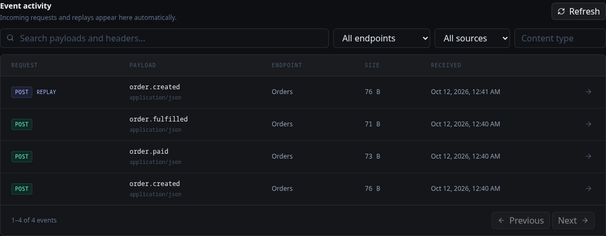
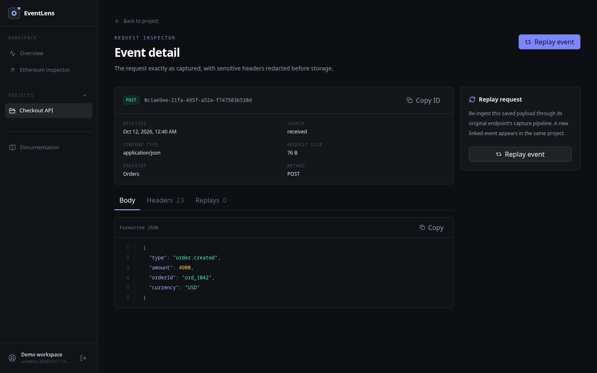
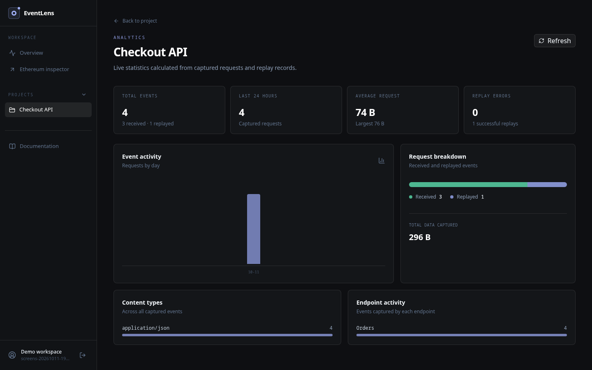

# EventLens

EventLens captures HTTP POST requests at project-specific webhook URLs. It saves each request in PostgreSQL so you can inspect its body and headers, search event history, replay it through its original capture endpoint, and check project activity. A separate read-only page inspects Ethereum mainnet transactions.

Built with Next.js, Better Auth, Drizzle, PostgreSQL, and viem. The app has no AI features or AI API dependencies.

## Screenshots

These are browser captures from a local test project after three real POST requests and one replay. The analytics counts are calculated from the saved events.

**Event history**



**Request detail**



**Project analytics**



## Features

- Email/password registration and sessions with Better Auth, plus project ownership checks on private routes.
- Project creation, rename, deletion, and isolated webhook endpoints with unpredictable capture tokens.
- Real POST ingestion with a 256 KiB body limit, sensitive-header redaction, JSON/text inspection, and PostgreSQL persistence.
- Searchable and paginated event history, details, request body and header views, and project analytics from stored events.
- Replays tied to the original endpoint, with a new event and replay status record. No arbitrary replay destination is accepted.
- Ethereum mainnet transaction inspection with status, gas, logs, and standard ERC-20 `Transfer` decoding using viem.
- Docker Compose, Drizzle migrations, automated checks, and a Vercel-compatible deployment path.

## Local setup

Requirements: Node.js 22 or newer, npm, and PostgreSQL 17 or newer. Docker Compose is an alternative to installing PostgreSQL locally.

### Docker Compose

```bash
cp .env.example .env
# Edit .env: set POSTGRES_PASSWORD to a URL-safe random value and
# BETTER_AUTH_SECRET to a different random value of at least 32 characters.
docker compose up --build
```

The app is available at [http://localhost:3000](http://localhost:3000). Compose waits for PostgreSQL, runs the committed migrations, then starts Next.js. The database is stored in the `postgres_data` volume. Docker binds the app and database ports to localhost for local use.

### Node.js and an existing PostgreSQL server

```bash
cp .env.example .env
# Edit DATABASE_URL, BETTER_AUTH_SECRET, BETTER_AUTH_URL, and NEXT_PUBLIC_APP_URL.
npm ci
npm run db:migrate
npm run dev
```

`drizzle.config.ts` reads `.env` for migrations. Next.js also reads `.env` for the application. Keep the file private; it is ignored by Git. Use `openssl rand -hex 32` to generate the auth secret. For a remote database, use its TLS connection URL.

### First webhook

1. Register at `/sign-up` and create a project from the dashboard.
2. Open the project and create an endpoint. Copy its capture URL.
3. Send a request using the copied URL:

```bash
export WEBHOOK_URL='https://your-eventlens-host/api/hooks/your-endpoint-token'
curl -i -X POST "$WEBHOOK_URL" \
  -H 'Content-Type: application/json' \
  -H 'X-Trace-Id: local-check-1' \
  -d '{"type":"order.created","orderId":"example-1"}'
```

The capture route returns HTTP `202` after the event is saved. Open the project dashboard to inspect it, search for `example-1`, and replay it. Replace the example URL with the endpoint URL shown in your own workspace.

## Development checks

```bash
npm run lint
npx tsc --noEmit
npm run test
npm run build
npx playwright install chromium
npm run test:e2e
```

The end-to-end suite requires a running PostgreSQL database and the environment variables above. GitHub Actions provisions an isolated PostgreSQL service, applies migrations, and runs these checks. Tests use fixtures only inside the test suite; the application has no fixture data or mock backend.

## Deployment

For Vercel, connect the repository as a Next.js project and attach a managed PostgreSQL database such as Neon through the Vercel Marketplace. Configure these production variables:

| Variable | Purpose |
| --- | --- |
| `DATABASE_URL` | PostgreSQL connection URL, preferably the provider's pooled/TLS URL for runtime. |
| `BETTER_AUTH_SECRET` | Unique random secret of at least 32 characters. |
| `BETTER_AUTH_URL` | Exact HTTPS origin of the deployed app. |
| `NEXT_PUBLIC_APP_URL` | Same public HTTPS origin; used to display webhook URLs. |
| `ETHEREUM_RPC_URL` | Ethereum mainnet JSON-RPC URL. Defaults to `https://ethereum.publicnode.com`. |

Run `npm run db:migrate` against the production database from a trusted environment before accepting traffic. Use a direct database URL for migrations if the provider separates direct and pooled URLs. Then deploy and test registration, webhook capture, replay, analytics, and Ethereum inspection on the live URL. Do not point a live deployment at the local Compose database. See [deployment details](docs/deployment.md).

## Documentation

- [API and curl reference](docs/api.md)
- [Architecture and security model](docs/architecture.md)
- [Security review](docs/security-review.md)
- [Deployment](docs/deployment.md)
- [Troubleshooting](docs/troubleshooting.md)

## Operational limits

The capture token is a bearer secret for sending requests to an endpoint; anyone with the URL can submit events. Payload bodies may contain sensitive data and are stored as received, while sensitive **header values** are redacted before persistence. Deployments should add a retention policy, backups, and network-level abuse protection appropriate to their use. The included endpoint rate limit is 120 saved events per minute, enforced through PostgreSQL. Ethereum inspection depends on the configured RPC's availability and rate limits. ERC-20 values are shown in raw token units because token metadata is not fetched.

## Development provenance and license

This project was implemented with assistance from OpenAI Codex. The runtime contains no AI models, AI APIs, or generated responses. EventLens is released under the [MIT License](LICENSE).
