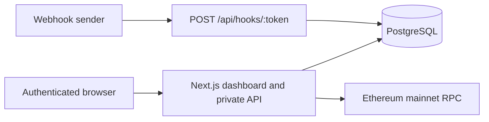

# Architecture and security

EventLens uses the Next.js App Router for the UI and Node.js route handlers, PostgreSQL for durable data, Drizzle ORM for typed queries and migrations, Better Auth for password accounts and sessions, and viem for read-only Ethereum mainnet RPC calls.

## Data model

Better Auth owns `user`, `session`, `account`, and `verification`. EventLens adds `projects`, `webhook_endpoints`, `events`, and `replays`. A project belongs to one user. An endpoint belongs to one project and carries a unique random capture token. An event belongs to a project and endpoint. A replay record links the original event to the new event and records status. Foreign keys cascade owned data when a project or endpoint is deleted; indexes support owner lookups and reverse-chronological event queries.

The capture path reads a bounded request stream, checks the endpoint's database-backed per-minute limit, normalizes its content type, redacts sensitive header values, and persists both an inspectable representation and original body bytes. The event becomes visible in the UI after the `202` response. JSON parsing is best effort; malformed JSON is still stored as text and bytes.

The replay route first proves the signed-in user owns the event's project, then re-ingests the original saved bytes through the same capture service with the original endpoint row. It does not accept a URL or perform an outbound fetch, which removes replay-driven server-side request forgery. The new event records its source and original event ID; the replay table records success or failure.

Analytics executes aggregate SQL over real project events. Daily activity is grouped by UTC date. The event list applies validated pagination and filters in SQL. It joins the project ownership boundary before returning private event details.

The Ethereum route accepts only an exact 32-byte transaction hash. viem sends reads to the server-configured RPC endpoint, checks that it is mainnet, fetches the transaction and receipt, and converts bigint fields to strings for JSON. The decoder recognizes the standard three-topic ERC-20 `Transfer(address,address,uint256)` log shape. Four-topic ERC-721 transfers and malformed logs are omitted from the ERC-20 list; all receipt logs remain inspectable in raw form.

## Trust boundaries

- Dashboard pages and private API routes require a valid session. Project, endpoint, event, replay, and analytics queries include owner checks. A missing or foreign resource returns an error without its data.
- Capture URLs are bearer capabilities for inbound POSTs. Possession permits submitting events, so URLs should be shared only with intended webhook senders. Endpoint tokens are generated with cryptographic random bytes.
- Request bodies are untrusted. The 256 KiB limit is enforced while streaming, including requests without a `Content-Length` header. Input JSON and pagination parameters are validated. Drizzle parameterizes SQL values.
- Sensitive header values are redacted before database storage and never recoverable for replay. Body content is stored unredacted to enable inspection and replay; users must control what they send and define retention policies for production.
- The Ethereum RPC URL comes only from server environment configuration. A browser-supplied hash cannot redirect the server. RPC errors return sanitized messages rather than credentials or provider URLs.
- Better Auth hashes passwords and manages sessions. Production must use a unique secret, HTTPS origin, secure cookies, and managed database backups.

## Runtime considerations

The app is compatible with Vercel's Node.js runtime and managed PostgreSQL. The `postgres` client limits each server process to five connections and disables prepared statements for pooler compatibility. The endpoint rate limit is enforced with a PostgreSQL count over recent saved events; deployments with high concurrency should add an upstream distributed rate limiter or WAF. Database migrations are a deployment operation and must complete before sending traffic to a new schema.
